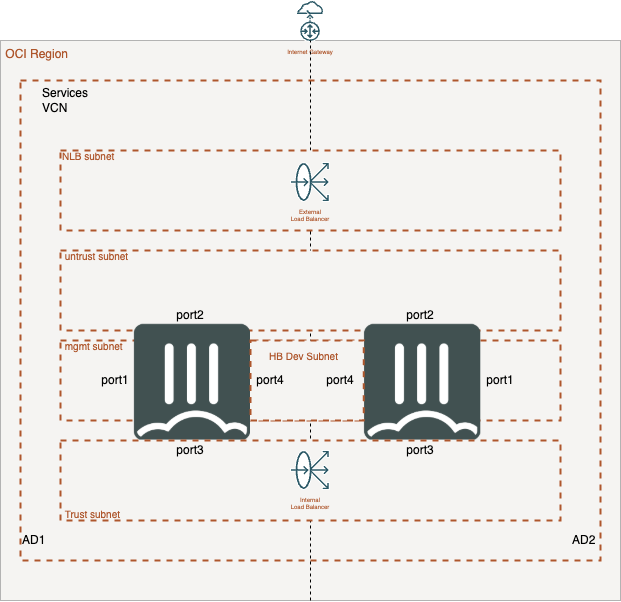

## oci-ap

This Terraform deploy Active/Passive FortiGate in Security Services VCN with 5 subnets.

You may run into an issue where cloudinit fails to load the full FortiGate Configuration.  Usually, this happens on the vNICs attached to the instance after initial bootup.  You will need to ssh to the FortiGate and issue the ```exec factoryreset``` command.  This will cause the cloudinit to run again.  When the device comes up, it should be functioning properly:

This terraform can resolve the marketplace image dynamically from the listing display name and version. By default it looks up the current PAYGO FortiGate listing, so you usually only need to set `mp_listing_display_name` and `mp_listing_resource_version` if you want a different listing or version. If needed, you can still override the lookup by setting `mp_listing_id` and `mp_listing_resource_id` explicitly.

fgt_byol_license_a
fgt_byol_license_b
fgt_byol_flexvm_license_a
fgt_byol_flexvm_license_b

The image used in this repo is for 7.4.7 BYOL, which allows users to specify a licencse file or flex token.

**If using BYOL License**, upload two license files into the home directory and specify the filenames using the below variables in terraform.tfvars

fgt_byol_license_a
fgt_byol_license_b

**If using Flex Token**, specify two flex tokens using the below variables in terraform.tfvars

fgt_byol_flexvm_license_a
fgt_byol_flexvm_license_b

## Bring your own network (existing VCN/subnets)

By default this template creates the VCN, internet gateway, all subnets, route tables and security lists. If you have already provisioned a network, you can reuse it instead by setting `create_network = false` and supplying the OCIDs of the existing VCN and subnets in `terraform.tfvars`:

```hcl
create_network                = false
existing_vcn_id               = "<vcn ocid>"
existing_untrusted_subnet_id  = "<untrusted subnet ocid>"
existing_trusted_subnet_id    = "<trusted subnet ocid>"
existing_hbdev_subnet_id      = "<heartbeat subnet ocid>"
existing_management_subnet_id = "<management subnet ocid>"
```

When `create_network = true` (the default), the existing-network variables are ignored and the network is built as before.

Notes when reusing an existing network:

- The FortiGate gateway IPs used during bootstrap are resolved automatically from the supplied subnets (their `virtual_router_ip`), so no extra input is required.
- **The FortiGate IP variables must fall inside your existing subnets' CIDRs.** The `fgt_ipaddress_a`, `fgt_ipaddress_b`, `unt_float_ipaddress`, `tr_float_ipaddress`, `trusted_nlb_ipaddress` and `subnetmask` values still default to the built-in `172.16.140.0/22` layout. If your existing subnets use different ranges, override these in `terraform.tfvars` to match, otherwise OCI rejects the VNIC with `IP Address is invalid: not in CIDR`.
- The trusted subnet's route table is **not** managed by this template in this mode. You must configure your trusted subnet to route `0.0.0.0/0` to the FortiGate trusted float IP. After `terraform apply`, use the `Trusted_Float_Private_IP` (or `Trusted_Float_Private_IP_OCID`) output to create that route rule.

